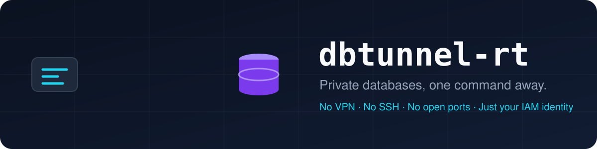
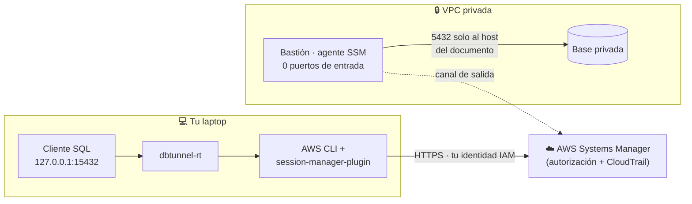

<div align="center">
  

  **Llega a una base de datos privada desde tu laptop con un solo comando.**<br/>
  *Sin VPN. Sin llaves SSH. Sin puertos abiertos. Sin listas de IPs. Solo tu identidad de AWS.*

  [](https://github.com/dyddtechnologies/dbtunnel-rt/releases/latest)
  [](https://github.com/dyddtechnologies/dbtunnel-rt/releases)
  [](#-instalación)
  [](./LICENSE)
  [](#-licencia)
  [](https://www.dyddtech.com)

  [English](./README.md) · **Español**

  [Instalación](#-instalación) · [Inicio rápido](#-inicio-rápido) · [Cómo funciona](#-cómo-funciona) · [Comandos](#-comandos) · [Archivo de bases](#-el-archivo-de-bases) · [Administradores](#-para-administradores) · [Problemas](#-si-algo-falla) · [Preguntas](#-preguntas-frecuentes)
</div>

---

```console
$ dbtunnel-rt orders-dev
dbtunnel-rt: orders-dev (orders-dev.cluster-example…:5432) -> 127.0.0.1:15432 via db-bastion-example (i-0123…); Ctrl-C to close
Port 15432 opened for sessionId alice-0a1b2c3d4e5f.
Waiting for connections...

$ psql "host=127.0.0.1 port=15432 dbname=orders sslmode=require"   # en otra terminal
```

## ✨ Por qué dbtunnel-rt

| | |
|---|---|
| 🔐 **Cero exposición** | Tu base sigue privada. El bastión **no tiene puertos de entrada**: solo mantiene un canal de salida hacia AWS Systems Manager. |
| 🎯 **Una base por túnel** | Cada base está atada a un documento SSM que **fija host y puerto**, así que el túnel no puede apuntar a otro lado. |
| 🪪 **Tu identidad, no una llave** | El acceso es tu usuario IAM o tu rol SSO. Cada sesión queda en CloudTrail. No hay llaves SSH que rotar ni contraseñas compartidas. |
| ♻️ **Se repara solo** | Si la sesión se corta (inactividad, cambio de Wi-Fi, bastión reemplazado), reconecta solo hasta que presionas `Ctrl-C`. |
| 🧹 **Cierre limpio** | `Ctrl-C` o cualquier señal de parada también terminan la sesión SSM del lado de AWS. No quedan sesiones huérfanas. |
| 🩺 **Diagnóstico incluido** | `dbtunnel-rt doctor` revisa herramientas, identidad, bastión y agente, y te dice cómo arreglar cada cosa. |
| 📦 **Un solo binario** | Cerca de 1 MB, sin runtime y sin dependencias aparte del AWS CLI. macOS y Linux, Intel y ARM. |

## 🚀 Instalación

**En una línea** (macOS · Linux · WSL2). Detecta tu plataforma, verifica el SHA-256 e instala en `~/.local/bin` sin sudo:

```bash
curl -fsSL https://raw.githubusercontent.com/dyddtechnologies/dbtunnel-rt/main/install.sh | sh
```

<details>
<summary><b>Instalación manual / fijar una versión</b></summary>

| Plataforma | Binario |
|---|---|
| macOS · Apple Silicon (M1–M4) | [`dbtunnel-rt-darwin-arm64`](https://github.com/dyddtechnologies/dbtunnel-rt/releases/latest/download/dbtunnel-rt-darwin-arm64) |
| macOS · Intel | [`dbtunnel-rt-darwin-amd64`](https://github.com/dyddtechnologies/dbtunnel-rt/releases/latest/download/dbtunnel-rt-darwin-amd64) |
| Linux · x86_64 (también WSL2) | [`dbtunnel-rt-linux-amd64`](https://github.com/dyddtechnologies/dbtunnel-rt/releases/latest/download/dbtunnel-rt-linux-amd64) |
| Linux · ARM64 | [`dbtunnel-rt-linux-arm64`](https://github.com/dyddtechnologies/dbtunnel-rt/releases/latest/download/dbtunnel-rt-linux-arm64) |

```bash
ART=dbtunnel-rt-darwin-arm64        # elige el tuyo de la tabla
curl -fsSLO "https://github.com/dyddtechnologies/dbtunnel-rt/releases/latest/download/$ART"
curl -fsSLO "https://github.com/dyddtechnologies/dbtunnel-rt/releases/latest/download/SHA256SUMS"
grep " $ART\$" SHA256SUMS | shasum -a 256 -c        # Linux: sha256sum -c
install -m 0755 "$ART" ~/.local/bin/dbtunnel-rt
```

- **Fijar una versión:** `curl -fsSL …/install.sh | DBTUNNEL_VERSION=v1.0.0 sh`.
- **Otra carpeta:** `DBTUNNEL_BIN_DIR=/usr/local/bin`.
- **macOS, bajado con el navegador:** si dice *"no se puede abrir porque es de un desarrollador no identificado"*, corre `xattr -d com.apple.quarantine ~/.local/bin/dbtunnel-rt`.
</details>

### Requisitos

| Necesitas | Para qué | Cómo |
|---|---|---|
| **AWS CLI v2** | Firma las llamadas con tu identidad | [Guía](https://docs.aws.amazon.com/cli/latest/userguide/getting-started-install.html) · `brew install awscli` |
| **Plugin de Session Manager** | Lleva los bytes del túnel | [Guía](https://docs.aws.amazon.com/systems-manager/latest/userguide/session-manager-working-with-install-plugin.html) · `brew install --cask session-manager-plugin` |
| **Un perfil de AWS** con permiso de túnel | Quién eres | `aws configure --profile <nombre>` o `aws configure sso` |
| **Un archivo de bases** | A qué bases puedes llegar | Te lo da tu equipo de plataforma ([formato](#-el-archivo-de-bases)) |

## ⚡ Inicio rápido

```bash
# 1. Dile a dbtunnel-rt qué bases existen (tu equipo te da este archivo)
mkdir -p ~/.config/dbtunnel && cp bases.conf ~/.config/dbtunnel/bases.conf

# 2. Revisa todo antes de abrir nada
export AWS_PROFILE=mi-perfil
dbtunnel-rt doctor orders-dev

# 3. Abre el túnel (déjalo corriendo) y conéctate a 127.0.0.1 desde tu cliente SQL
dbtunnel-rt orders-dev
```

<details>
<summary><b>Cómo se ve un <code>doctor</code> sano</b></summary>

```console
$ dbtunnel-rt doctor orders-dev
dbtunnel-rt v1.0.0 doctor
  ok    aws cli v2
  ok    session-manager-plugin
  ok    bases file /Users/alice/.config/dbtunnel/bases.conf
  ok    AWS identity: arn:aws:iam::111111111111:user/alice (profile: mi-perfil)
  ok    bastion db-bastion-example: i-0123456789abcdef0 (us-east-1)
  ok    SSM agent Online
  info  document db-tunnel-example-orders (only this database is reachable)
```
</details>

### Conecta tu cliente

| Campo | Valor |
|---|---|
| Host | **`127.0.0.1`**. No `localhost`: el plugin solo escucha en IPv4. |
| Puerto | El puerto local de la base (`dbtunnel-rt list`) |
| SSL | **`require`**. `verify-full` falla porque el certificado nombra al host real. |
| Usuario / contraseña | Tu propio usuario de base |

Funciona con **psql, DBeaver, DataGrip, TablePlus, pgAdmin**, ORMs y cualquier cosa que se conecte a un host y un puerto.

## 🧭 Cómo funciona



1. **Busca el bastión.** `dbtunnel-rt` lo ubica por su tag `Name`, nunca por IP, así que si el bastión se reemplaza sigue funcionando.
2. **Inicia la sesión.** Pide a SSM una sesión de port forwarding con el **documento de host fijo** de la base.
3. **Autoriza.** IAM revisa que puedas usar ese documento en ese bastión. Cualquier otra cosa, shell incluido, se niega.
4. **Retransmite.** SSM pasa tu puerto local por el agente del bastión hasta la base.
5. **Cierra.** Con `Ctrl-C` se termina la sesión, se libera el puerto y no queda nada abierto.

## 🛠 Comandos

| Comando | Qué hace |
|---|---|
| `dbtunnel-rt list` | Bases de tu archivo, con su puerto local |
| `dbtunnel-rt doctor [base]` | Revisa herramientas, archivo, identidad, bastión y agente, con el arreglo de cada falla |
| `dbtunnel-rt <base>` | Abre el túnel en el puerto local de la base |
| `dbtunnel-rt <base> --port 25432` | Lo mismo, en otro puerto local |
| `dbtunnel-rt version` | Versión instalada |

| Opción / variable | Para qué |
|---|---|
| `--profile P` · `AWS_PROFILE` | Perfil de AWS |
| `--bases FILE` · `DBTUNNEL_BASES` | Archivo de bases (por defecto `~/.config/dbtunnel/bases.conf`) |
| `DBTUNNEL_RETRIES` | Reintentos si se corta (`0` = hasta `Ctrl-C`) |

## 📄 El archivo de bases

Una línea por base. Se ignoran las líneas vacías y los comentarios `#`. Ver [`examples/bases.example.conf`](examples/bases.example.conf).

```text
# name       | region    | bastion Name tag   | SSM document              | remote host:port (info)                                     | local port
orders-dev   | us-east-1 | db-bastion-example | db-tunnel-example-orders  | orders-dev.cluster-example.us-east-1.rds.amazonaws.com:5432 | 15432
billing-dev  | us-east-1 | db-bastion-example | db-tunnel-example-billing | billing-dev.cluster-example.us-east-1.rds.amazonaws.com:5432| 15433
```

> **El documento SSM decide a dónde va el túnel.** La columna del host solo se te muestra a ti.
> Agregar una línea nunca da acceso: el documento y el permiso los crea tu equipo de plataforma.

## 🏛 Para administradores

`dbtunnel-rt` funciona con cualquier cuenta de AWS. Necesitas tres piezas, idealmente como código.

<details>
<summary><b>1 · Un bastión sin puertos de entrada</b></summary>

- **Instancia:** una pequeña (p. ej. `t4g.nano`) en la VPC de la base, con el agente SSM (Amazon Linux 2023 lo trae) y el rol `AmazonSSMManagedInstanceCore`.
- **Su security group:** **sin ingress**. Egress al 443 (endpoints de SSM) y a los puertos de las bases.
- **El security group de la base:** permite el **security group del bastión**, nunca una IP.
</details>

<details>
<summary><b>2 · Un documento SSM de host fijo por base</b></summary>

```json
{
  "schemaVersion": "1.0",
  "description": "Port forwarding to orders-dev only",
  "sessionType": "Port",
  "parameters": {
    "localPortNumber": { "type": "String", "allowedPattern": "^[0-9]{1,5}$", "default": "0" }
  },
  "properties": {
    "type": "LocalPortForwarding",
    "host": "orders-dev.cluster-example.us-east-1.rds.amazonaws.com",
    "portNumber": "5432",
    "localPortNumber": "{{ localPortNumber }}"
  }
}
```

```bash
aws ssm create-document --name db-tunnel-example-orders --document-type Session \
  --document-format JSON --content file://db-tunnel-example-orders.json
```
</details>

<details>
<summary><b>3 · Una política IAM de mínimo privilegio</b></summary>

```json
{
  "Version": "2012-10-17",
  "Statement": [
    {
      "Sid": "PortForwardThroughBastionOnly",
      "Effect": "Allow",
      "Action": "ssm:StartSession",
      "Resource": [
        "arn:aws:ec2:us-east-1:111111111111:instance/i-0123456789abcdef0",
        "arn:aws:ssm:us-east-1:111111111111:document/db-tunnel-example-orders"
      ],
      "Condition": { "BoolIfExists": { "ssm:SessionDocumentAccessCheck": "true" } }
    },
    {
      "Sid": "ManageOwnSessions",
      "Effect": "Allow",
      "Action": ["ssm:TerminateSession", "ssm:ResumeSession"],
      "Resource": "arn:aws:ssm:*:111111111111:session/${aws:username}-*"
    },
    {
      "Sid": "Discover",
      "Effect": "Allow",
      "Action": ["ec2:DescribeInstances", "ssm:DescribeInstanceInformation", "ssm:DescribeSessions"],
      "Resource": "*"
    }
  ]
}
```

- **`SessionDocumentAccessCheck`** hace que SSM rechace cualquier documento que no esté en la lista. Eso descarta el shell por defecto y el genérico `AWS-StartPortForwardingSessionToRemoteHost`.
- **Para quitar una base a todos:** saca su documento de la política.
- **Los usuarios con `AdministratorAccess`** no quedan limitados por esta política. Pruébala con `aws iam simulate-custom-policy`.
</details>

## 🩹 Si algo falla

| Ves esto | Significa | Haz esto |
|---|---|---|
| `doctor` → FAIL aws cli v2 / session-manager-plugin | Falta una herramienta | Ver [Requisitos](#requisitos) |
| `doctor` → FAIL bases file | No hay archivo de bases | Ponlo en `~/.config/dbtunnel/bases.conf` |
| `doctor` → FAIL AWS identity | Perfil inexistente o vencido | `aws configure --profile …` / `aws sso login` |
| `doctor` → FAIL bastion | No puedes verlo, o está caído | Pide la política del túnel a tu equipo de plataforma |
| `AccessDeniedException` al abrir | No tienes permiso para el documento de esa base | Usa solo las bases de `dbtunnel-rt list` |
| `127.0.0.1:15432 is already in use` | Ya hay un túnel abierto | Reúsalo, o `--port 25432` |
| `Connection refused` en `localhost` | El cliente intentó IPv6 (`::1`) | Usa `127.0.0.1` |
| `certificate verify failed` | `sslmode=verify-full` | Usa `require` |
| La primera consulta tarda ~20 s | Una base serverless despertando | Normal; las siguientes van rápido |
| `TargetNotConnected` | El bastión se está reemplazando | Espera 2–3 min; `dbtunnel-rt` reintenta solo |

## ❓ Preguntas frecuentes

<details><summary><b>¿Es una VPN?</b></summary>

No. Reenvía **un puerto local** a **una base**, y nada más de tu máquina toca la red de atrás.
</details>

<details><summary><b>¿Alguien en mi Wi-Fi puede usar mi túnel?</b></summary>

No. Escucha solo en `127.0.0.1`.
</details>

<details><summary><b>¿Guarda credenciales?</b></summary>

No. Las de AWS quedan en tu perfil del AWS CLI y las de la base en tu cliente SQL. `dbtunnel-rt` no toca ninguna.
</details>

<details><summary><b>¿Funciona con AWS SSO / Identity Center?</b></summary>

Sí. Sirve cualquier perfil que pueda usar el AWS CLI, incluidos SSO, roles asumidos y `credential_process`.
</details>

<details><summary><b>¿Windows?</b></summary>

Usa **WSL2** con el binario `linux-amd64`. Tu cliente SQL de Windows llega a `127.0.0.1` dentro de WSL2.
</details>

<details><summary><b>¿Lo pueden usar mis scripts y herramientas?</b></summary>

Sí. Arráncalo en segundo plano y detenlo con `SIGINT`/`SIGTERM`: siempre cierra la sesión SSM limpia.
</details>

## 🔄 Actualizar y desinstalar

```bash
curl -fsSL https://raw.githubusercontent.com/dyddtechnologies/dbtunnel-rt/main/install.sh | sh   # actualizar
rm ~/.local/bin/dbtunnel-rt && rm -rf ~/.config/dbtunnel                                          # desinstalar
```

## 💬 Soporte

¿Encontraste un error o tienes una idea? [Abre un issue](https://github.com/dyddtechnologies/dbtunnel-rt/issues). Incluye la salida de `dbtunnel-rt version` y `dbtunnel-rt doctor`. **Quita antes los IDs de cuenta y los hostnames.**

## 📜 Licencia

**Gratis para usar, también comercialmente**, bajo la [Licencia MIT](./LICENSE). Este repositorio distribuye los binarios y cómo usarlos.

---

<div align="center">
  <sub><b>dbtunnel-rt</b> — una herramienta gratuita de <a href="https://www.dyddtech.com"><b>D&DD Tech</b></a> · Copyright © 2026 D&DD Inversiones</sub>
</div>
