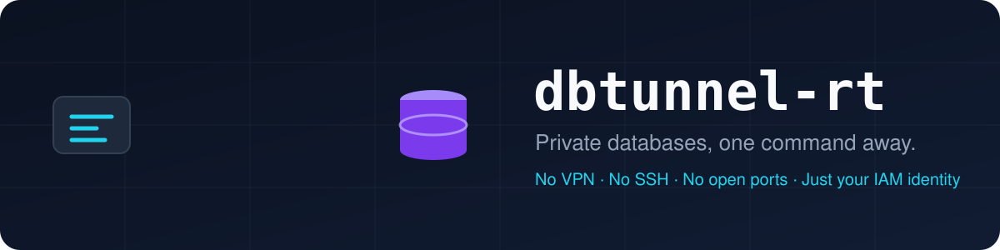
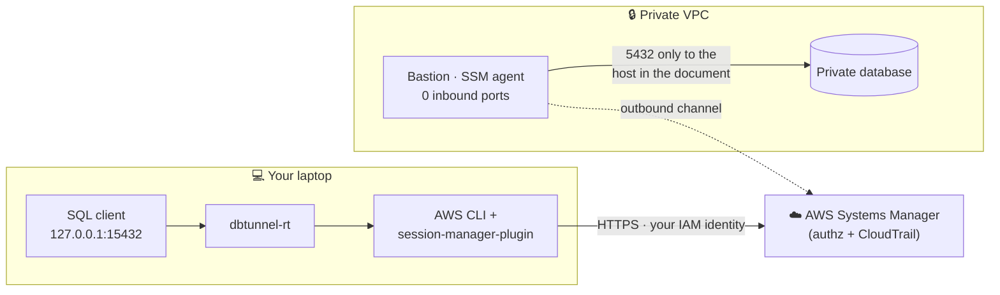

<div align="center">
  

  **Reach a private database from your laptop with one command.**<br/>
  *No VPN. No SSH keys. No open ports. No IP allowlists. Just your AWS identity.*

  [](https://github.com/dyddtechnologies/dbtunnel-rt/releases/latest)
  [](https://github.com/dyddtechnologies/dbtunnel-rt/releases)
  [](#-install)
  [](./LICENSE)
  [](#-license)
  [](https://www.dyddtech.com)

  **English** · [Español](./README.es.md)

  [Install](#-install) · [Quick start](#-quick-start) · [How it works](#-how-it-works) · [Commands](#-commands) · [Bases file](#-the-bases-file) · [For admins](#-for-administrators) · [Troubleshooting](#-troubleshooting) · [FAQ](#-faq)
</div>

---

```console
$ dbtunnel-rt orders-dev
dbtunnel-rt: orders-dev (orders-dev.cluster-example…:5432) -> 127.0.0.1:15432 via db-bastion-example (i-0123…); Ctrl-C to close
Port 15432 opened for sessionId alice-0a1b2c3d4e5f.
Waiting for connections...

$ psql "host=127.0.0.1 port=15432 dbname=orders sslmode=require"   # in another terminal
```

## ✨ Why dbtunnel-rt

| | |
|---|---|
| 🔐 **Zero exposure** | Your database stays private. The bastion has **no inbound ports**: it only keeps an outbound channel to AWS Systems Manager. |
| 🎯 **One database per tunnel** | Each base is pinned to an SSM document that **fixes host and port**, so a tunnel can never be pointed somewhere else. |
| 🪪 **Your identity, not a key** | Access is your IAM user or SSO role. Every session is recorded in CloudTrail. There are no SSH keys to rotate and no shared passwords. |
| ♻️ **Self-healing** | If the session drops (idle timeout, Wi-Fi change, bastion replaced), it reconnects on its own until you press `Ctrl-C`. |
| 🧹 **Clean exit** | `Ctrl-C` or any stop signal ends the SSM session on AWS's side, too. No orphan sessions. |
| 🩺 **Built-in doctor** | `dbtunnel-rt doctor` checks your tools, identity, bastion and agent, and tells you the fix for each problem. |
| 📦 **Single static binary** | About 1 MB, no runtime and no dependencies besides the AWS CLI. macOS and Linux, Intel and ARM. |

## 🚀 Install

**One line** (macOS · Linux · WSL2). It detects your platform, verifies the SHA-256 and installs to `~/.local/bin` without sudo:

```bash
curl -fsSL https://raw.githubusercontent.com/dyddtechnologies/dbtunnel-rt/main/install.sh | sh
```

<details>
<summary><b>Manual install / pin a version</b></summary>

| Platform | Binary |
|---|---|
| macOS · Apple Silicon (M1–M4) | [`dbtunnel-rt-darwin-arm64`](https://github.com/dyddtechnologies/dbtunnel-rt/releases/latest/download/dbtunnel-rt-darwin-arm64) |
| macOS · Intel | [`dbtunnel-rt-darwin-amd64`](https://github.com/dyddtechnologies/dbtunnel-rt/releases/latest/download/dbtunnel-rt-darwin-amd64) |
| Linux · x86_64 (also WSL2) | [`dbtunnel-rt-linux-amd64`](https://github.com/dyddtechnologies/dbtunnel-rt/releases/latest/download/dbtunnel-rt-linux-amd64) |
| Linux · ARM64 | [`dbtunnel-rt-linux-arm64`](https://github.com/dyddtechnologies/dbtunnel-rt/releases/latest/download/dbtunnel-rt-linux-arm64) |

```bash
ART=dbtunnel-rt-darwin-arm64        # pick yours from the table
curl -fsSLO "https://github.com/dyddtechnologies/dbtunnel-rt/releases/latest/download/$ART"
curl -fsSLO "https://github.com/dyddtechnologies/dbtunnel-rt/releases/latest/download/SHA256SUMS"
grep " $ART\$" SHA256SUMS | shasum -a 256 -c        # Linux: sha256sum -c
install -m 0755 "$ART" ~/.local/bin/dbtunnel-rt
```

- **Pin a version:** `curl -fsSL …/install.sh | DBTUNNEL_VERSION=v1.0.0 sh`.
- **Other directory:** `DBTUNNEL_BIN_DIR=/usr/local/bin`.
- **macOS, file downloaded with a browser:** if it says *"cannot be opened because the developer cannot be verified"*, run `xattr -d com.apple.quarantine ~/.local/bin/dbtunnel-rt`.
</details>

### Requirements

| You need | Why | Get it |
|---|---|---|
| **AWS CLI v2** | Signs the requests with your identity | [Install guide](https://docs.aws.amazon.com/cli/latest/userguide/getting-started-install.html) · `brew install awscli` |
| **Session Manager plugin** | Carries the tunnel bytes | [Install guide](https://docs.aws.amazon.com/systems-manager/latest/userguide/session-manager-working-with-install-plugin.html) · `brew install --cask session-manager-plugin` |
| **An AWS profile** with tunnel permissions | Who you are | `aws configure --profile <name>` or `aws configure sso` |
| **A bases file** | Which databases you can reach | Given by your platform team ([format](#-the-bases-file)) |

## ⚡ Quick start

```bash
# 1. Tell dbtunnel-rt which databases exist (your team gives you this file)
mkdir -p ~/.config/dbtunnel && cp bases.conf ~/.config/dbtunnel/bases.conf

# 2. Check everything before opening anything
export AWS_PROFILE=my-profile
dbtunnel-rt doctor orders-dev

# 3. Open the tunnel (leave it running) and connect to 127.0.0.1 from any SQL client
dbtunnel-rt orders-dev
```

<details>
<summary><b>What a healthy <code>doctor</code> looks like</b></summary>

```console
$ dbtunnel-rt doctor orders-dev
dbtunnel-rt v1.0.0 doctor
  ok    aws cli v2
  ok    session-manager-plugin
  ok    bases file /Users/alice/.config/dbtunnel/bases.conf
  ok    AWS identity: arn:aws:iam::111111111111:user/alice (profile: my-profile)
  ok    bastion db-bastion-example: i-0123456789abcdef0 (us-east-1)
  ok    SSM agent Online
  info  document db-tunnel-example-orders (only this database is reachable)
```
</details>

### Connect your client

| Setting | Value |
|---|---|
| Host | **`127.0.0.1`**. Not `localhost`: the plugin listens on IPv4 only. |
| Port | The base's local port (`dbtunnel-rt list`) |
| SSL mode | **`require`**. `verify-full` fails because the certificate names the real host. |
| User / password | Your own database user |

Works with **psql, DBeaver, DataGrip, TablePlus, pgAdmin**, ORMs, and anything else that connects to a host and port.

## 🧭 How it works



1. **Find the bastion.** `dbtunnel-rt` locates it by its `Name` tag, never by IP, so a replaced bastion just works.
2. **Start the session.** It asks SSM for a port-forwarding session with the base's **fixed-host document**.
3. **Authorize.** IAM checks that you may use that document on that bastion. Anything else, including a shell, is denied.
4. **Relay.** SSM relays your local port through the bastion's agent to the database.
5. **Close.** On `Ctrl-C`, the session is terminated, the port is freed and nothing stays open.

## 🛠 Commands

| Command | What it does |
|---|---|
| `dbtunnel-rt list` | Bases in your file, with local ports |
| `dbtunnel-rt doctor [base]` | Checks tools, file, identity, bastion and agent, with the fix for each failure |
| `dbtunnel-rt <base>` | Opens the tunnel on the base's local port |
| `dbtunnel-rt <base> --port 25432` | Same, on another local port |
| `dbtunnel-rt version` | Installed version |

| Flag / variable | Purpose |
|---|---|
| `--profile P` · `AWS_PROFILE` | AWS profile to use |
| `--bases FILE` · `DBTUNNEL_BASES` | Bases file (default `~/.config/dbtunnel/bases.conf`) |
| `DBTUNNEL_RETRIES` | Reconnect attempts after a drop (`0` = until `Ctrl-C`) |

## 📄 The bases file

One line per database. Blank lines and `#` comments are ignored. See [`examples/bases.example.conf`](examples/bases.example.conf).

```text
# name       | region    | bastion Name tag   | SSM document              | remote host:port (info)                                     | local port
orders-dev   | us-east-1 | db-bastion-example | db-tunnel-example-orders  | orders-dev.cluster-example.us-east-1.rds.amazonaws.com:5432 | 15432
billing-dev  | us-east-1 | db-bastion-example | db-tunnel-example-billing | billing-dev.cluster-example.us-east-1.rds.amazonaws.com:5432| 15433
```

> **The SSM document decides where the tunnel goes.** The host column is only shown to you.
> Adding a line never grants access: your platform team creates the document and the permission.

## 🏛 For administrators

`dbtunnel-rt` works with any AWS account. You need three pieces, ideally managed as code.

<details>
<summary><b>1 · A bastion that has no inbound ports</b></summary>

- **Instance:** a tiny instance (e.g. `t4g.nano`) in the database's VPC, with the SSM agent (Amazon Linux 2023 ships it) and the `AmazonSSMManagedInstanceCore` role.
- **Its security group:** **no ingress**. Egress is 443 (SSM endpoints) plus the database ports.
- **The database's security group:** allows the **bastion's security group**, never an IP.
</details>

<details>
<summary><b>2 · One fixed-host SSM document per database</b></summary>

```json
{
  "schemaVersion": "1.0",
  "description": "Port forwarding to orders-dev only",
  "sessionType": "Port",
  "parameters": {
    "localPortNumber": { "type": "String", "allowedPattern": "^[0-9]{1,5}$", "default": "0" }
  },
  "properties": {
    "type": "LocalPortForwarding",
    "host": "orders-dev.cluster-example.us-east-1.rds.amazonaws.com",
    "portNumber": "5432",
    "localPortNumber": "{{ localPortNumber }}"
  }
}
```

```bash
aws ssm create-document --name db-tunnel-example-orders --document-type Session \
  --document-format JSON --content file://db-tunnel-example-orders.json
```
</details>

<details>
<summary><b>3 · A least-privilege IAM policy for your users</b></summary>

```json
{
  "Version": "2012-10-17",
  "Statement": [
    {
      "Sid": "PortForwardThroughBastionOnly",
      "Effect": "Allow",
      "Action": "ssm:StartSession",
      "Resource": [
        "arn:aws:ec2:us-east-1:111111111111:instance/i-0123456789abcdef0",
        "arn:aws:ssm:us-east-1:111111111111:document/db-tunnel-example-orders"
      ],
      "Condition": { "BoolIfExists": { "ssm:SessionDocumentAccessCheck": "true" } }
    },
    {
      "Sid": "ManageOwnSessions",
      "Effect": "Allow",
      "Action": ["ssm:TerminateSession", "ssm:ResumeSession"],
      "Resource": "arn:aws:ssm:*:111111111111:session/${aws:username}-*"
    },
    {
      "Sid": "Discover",
      "Effect": "Allow",
      "Action": ["ec2:DescribeInstances", "ssm:DescribeInstanceInformation", "ssm:DescribeSessions"],
      "Resource": "*"
    }
  ]
}
```

- **`SessionDocumentAccessCheck`** makes SSM refuse any document that isn't listed. That rules out the default shell and the generic `AWS-StartPortForwardingSessionToRemoteHost`.
- **To revoke one database for everyone:** remove its document from the policy.
- **Users with `AdministratorAccess`** are not limited by this policy. Test it with `aws iam simulate-custom-policy`.
</details>

## 🩹 Troubleshooting

| You see | It means | Do this |
|---|---|---|
| `doctor` → FAIL aws cli v2 / session-manager-plugin | A tool is missing | See [Requirements](#requirements) |
| `doctor` → FAIL bases file | No bases file | Put it at `~/.config/dbtunnel/bases.conf` |
| `doctor` → FAIL AWS identity | Profile missing or expired | `aws configure --profile …` / `aws sso login` |
| `doctor` → FAIL bastion | No permission to see it, or it is down | Ask your platform team for the tunnel policy |
| `AccessDeniedException` on open | That base's document isn't allowed for you | Use only bases from `dbtunnel-rt list` |
| `127.0.0.1:15432 is already in use` | A tunnel is already open | Reuse it, or `--port 25432` |
| `Connection refused` on `localhost` | The client tried IPv6 (`::1`) | Use `127.0.0.1` |
| `certificate verify failed` | `sslmode=verify-full` | Use `require` |
| First query takes ~20 s | A serverless database waking up | Normal; the next ones are fast |
| `TargetNotConnected` | The bastion is being replaced | Wait 2–3 min; `dbtunnel-rt` retries on its own |

## ❓ FAQ

<details><summary><b>Is it a VPN?</b></summary>

No. It forwards **one local port** to **one database**, and nothing else of your machine touches the network behind it.
</details>

<details><summary><b>Can someone on my Wi-Fi use my tunnel?</b></summary>

No. It listens on `127.0.0.1` only.
</details>

<details><summary><b>Does it store credentials?</b></summary>

No. AWS credentials stay in your AWS CLI profile, and database passwords stay in your SQL client. `dbtunnel-rt` handles neither.
</details>

<details><summary><b>Does it work with AWS SSO / Identity Center?</b></summary>

Yes. Any profile the AWS CLI can use works, including SSO, assumed roles and `credential_process`.
</details>

<details><summary><b>Windows?</b></summary>

Use **WSL2** with the `linux-amd64` binary. Your Windows SQL client can reach `127.0.0.1` in WSL2.
</details>

<details><summary><b>Can my scripts and tools use it?</b></summary>

Yes. Start it in the background and stop it with `SIGINT`/`SIGTERM`: it always closes the SSM session cleanly.
</details>

## 🔄 Upgrade & uninstall

```bash
curl -fsSL https://raw.githubusercontent.com/dyddtechnologies/dbtunnel-rt/main/install.sh | sh   # upgrade
rm ~/.local/bin/dbtunnel-rt && rm -rf ~/.config/dbtunnel                                          # uninstall
```

## 💬 Support

Found a bug or have an idea? [Open an issue](https://github.com/dyddtechnologies/dbtunnel-rt/issues). Include the output of `dbtunnel-rt version` and `dbtunnel-rt doctor`. **Remove account IDs and hostnames first.**

## 📜 License

**Free to use, including commercially**, under the [MIT License](./LICENSE). This repository distributes the binaries and how to use them.

---

<div align="center">
  <sub><b>dbtunnel-rt</b> — a free tool by <a href="https://www.dyddtech.com"><b>D&DD Tech</b></a> · Copyright © 2026 D&DD Inversiones</sub>
</div>
